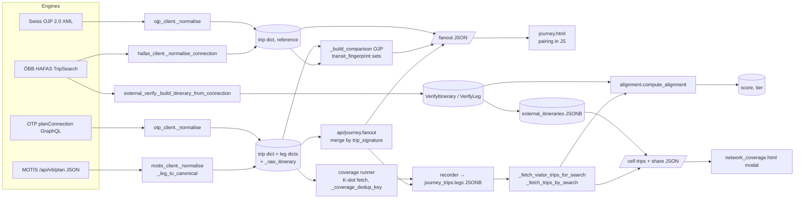
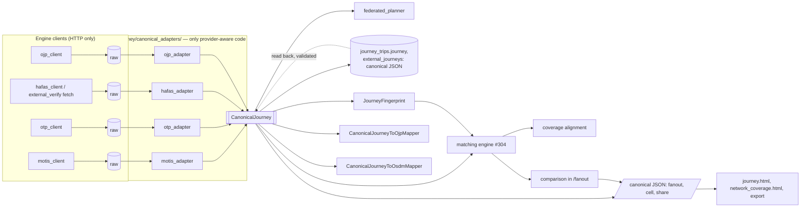

# CanonicalJourney — analysis and design proposal (#303, phase 1)

**Status**: PROPOSAL under review, 2026-11-04. This document contains no code change. Issue #303's
execution rule says: analyse first, propose the design, **wait for review**, then migrate. The
implementation PRs (§8) start once the owner has answered the decisions in §0.2. The owner decided
D1 (no backward compatibility) and D5 on 2026-11-04.
**Audience**: the owner (review), implementers of #303 and #304.
**Pairs with**:
- [journey-matching-engine-design.md](journey-matching-engine-design.md) — #304, built on this model.
- [journey-comparison-implementation.md](journey-comparison-implementation.md),
  [ojp-reference-comparison-design.md](ojp-reference-comparison-design.md) — the comparison as built.
- [architecture.md](architecture.md) ch. 3 (API), 4 (journey), 5 (coverage), 12 (proposed OJP API).

Everything marked *(read from code)* was found by reading the source at `f788a1f` and was not
reproduced against a live engine.

---

## 0. Summary

VIATOR asks four engines (MOTIS, OTP, ÖBB HAFAS, Swiss OJP) the same question and compares the
answers. Today the four clients already return one *dict shape* (`architecture.md` ch. 4, "the
canonical trip dict"), but **the same key carries different meanings depending on who filled it**
(§1.3). The clearest case: `route_short_name` is a line (`S7`) from MOTIS/OTP and a train label
(`RJ 1141`, `S 7`) from HAFAS. Every comparison then re-interprets those fields its own way, in four
different places with four different identity rules (§1.5), and two of them in browser JavaScript.

`CanonicalJourney` V1 replaces the dict with a typed, OJP-shaped model whose fields have **one
meaning**: a leg's line, its train number, its product category and its published name are separate
fields; a stop is a `StopPlace` (station, with codes by series) plus an optional `Quay` (platform);
every time is an aware UTC instant. Four adapters — the only code that knows a provider — fill it.
Everything above them (federation, recording, coverage, alignment, comparison, API, UI) reads only
`CanonicalJourney`.

### 0.1 What the owner sees change

| When | Visible effect |
|---|---|
| PR 2 (model + adapters) | Nothing. Characterisation tests prove the adapters carry every value today's normalisers give. |
| PR 3 (journey layer + API + `/journey`) | The page reads the new JSON; same display. The `{}` button shows the canonical journey instead of the engine's raw JSON (D3). |
| PR 4 (storage + coverage) | **All recorded journey searches and coverage runs are deleted** by the migration (D1); new ones are stored as canonical journeys. Same matrix, modal and share page. The scorer keeps today's rules (D5). |
| #304 | The comparison verdicts change: tolerant pairing, "S7" = "S 7", reasons shown. See the #304 design. |

### 0.2 Decisions requested from the review

| # | Question | Recommendation |
|---|---|---|
| D1 | Storage of journeys already persisted (`journey_trips.legs`, `network_coverage_results.external_itineraries`) | **Decided 2026-11-04: no backward compatibility.** Journeys are stored as canonical JSON only. PR 4's migration deletes every recorded journey search and coverage run (the owner restarts the journey tests and coverage runs from scratch). No legacy adapter, no old format to read, no backfill. |
| D2 | API shape | **Change `/api/journey/fanout` and the coverage cell/share endpoints in place**, together with the pages that read them, one PR each. Their only consumers are VIATOR's own pages; the versioned public API is ch. 12's `/api/v1/plan`, which will expose this model from day one. |
| D3 | Raw engine JSON in the UI (`_raw_itinerary`, the `{}` button) | **Remove it from the API**; the `{}` button shows the canonical journey. The raw answer stays in `journey_search_executions.raw_response` (database only). #303 rejects "provider DTOs exposed through public APIs". |
| D4 | Model technology | **Pydantic v2 frozen models** (`extra="forbid"`): validation at the adapter boundary, JSON Schema generated, already a dependency (2.14.1). |
| D5 | Does #303 change any comparison result? | **Decided 2026-11-04: no, with one exception.** #303 keeps `transit_fingerprint` and the alignment scorer's rules, ported to canonical input and golden-tested. The new `JourneyFingerprint` is introduced alongside; consumers switch to it in #304, where verdicts are meant to change. The exception: PR 4 fixes the coverage dedup key (§11 item 2), so a cell no longer merges trips of two stations that share a platform number, minute and route names (rare); such a cell then keeps one more trip than before. |
| D6 | Fingerprint and train numbers | Per #303, **`JourneyFingerprint` ignores train numbers and route names** (today's `transit_fingerprint` hashes `route_short_name`). Train identity becomes a matching feature in #304, not part of identity. |
| D7 | OJP/OSDM mappers | **Proof of concept in PR 2** (AC5): CanonicalJourney → OJP 2.0 `Trip` XML and JSON, → OSDM `Trip` JSON, for the fixture journeys, validated against the OJP XSD in a test. The full export layers stay #306 / #307. |
| D8 | Station identity | **Decided direction 2026-11-04: the station module (MSMM) is the mapping.** Journeys are compared by MSMM station (`station_id` = `station_module.current_id`). MSMM already links each feed's stops to stations (VIATOR sends it the stop extracts) and answers `POST /internal/v1/stops/resolve` with `{feed, stop}` or, for an ÖBB number, `{series: DELFI_stop_key, code}`. In #303: the adapters keep today's token rules for `uic`, and PR 2 adds `CanonicalStopPlace.station_id` and a `StationResolver` interface (no I/O). The resolver itself is a PR of its own before #304's wiring (§8): `stops/resolve` answers one stop per call within 60 calls a minute and 2 000 a day per person, enough for `/journey` with a cache, not for a coverage sweep, which needs a bulk form on the MSMM side. |

---

## 1. Current architecture

### 1.1 Journey lifecycle today



Two facts the diagram makes visible. ÖBB HAFAS has **two normalisers** with different output
(`hafas_client` for `/journey`, `external_verify` for coverage). And coverage **re-reads its VIATOR
trips from `journey_trips.legs`** before scoring (`runner.py:2167`), so any change of the stored
leg format meets old rows on resume or re-score.

### 1.2 Inventory of journey representations

| # | Representation | Built by | Read by | Persisted |
|---|---|---|---|---|
| R1 | MOTIS itinerary JSON | MOTIS | `motis_client` | `journey_search_executions.raw_response`; `_raw_itinerary` to the UI |
| R2 | OTP `planConnection.edges[].node` | OTP | `otp_client` | idem |
| R3 | HAFAS `outConL` + `common.locL/prodL/opL` | HAFAS | `hafas_client`, `external_verify` | no |
| R4 | OJP `OJPTripDelivery` XML | OJP | `ojp_client` | no |
| R5 | **trip dict / leg dict** (14 + 22 keys; `ojp_client._blank_leg` is the literal reference) | 4 clients: `otp_client._normalise:314`, `motis_client._normalise` + `_leg_to_canonical:292`, `hafas_client._normalise_connection:459` / `_normalise_section:513`, `ojp_client._normalise:364` / `_blank_leg` | everything below | `journey_trips` (selected keys + `legs` verbatim) |
| R6 | merged fanout slot `{signature, found_in_sessions, by_session, best, origin_flag, comparison}` | `api/journey._merge_by_signature:930` | `journey.html` | no |
| R7 | federated stitch = R5 + `via_hubs`, `stitched_from_sessions`, `federated` | `federated_planner.assemble_stitch` | `journey.html` | no |
| R8 | reference envelope `{status, trips, response_ms, error?, pages?, partial?, trimmed_to_viator_window?}` | `api/journey._query_ojp_reference`, `_query_hafas_reference` | `journey.html` | no |
| R9 | `VerifyLeg` / `VerifyItinerary` / `VerifyResult` (Pydantic; `dep_utc`/`arr_utc` naive Vienna time) | `external_verify:159-246` | `alignment`, `runner`, cell modal, export, share | `network_coverage_results.external_itineraries` |
| R10 | read-back trip dicts | `runner._fetch_viator_trips_for_search:1988`, `api/admin/network_coverage._fetch_trips_by_search:2498`, `CellTripsDirection` | alignment, modal, export, **public share** | — |
| R11 | JS view rows (`_pairViatorAndOebbTrips`, `_pairKey`, `_trainOnlySignature`) | `journey.html` | `journey.html` | no |

There is no `MotisTrip` / `OtpTrip` / `HafasTrip` class today. The provider-specific DTOs #303
forbids above the adapters are **R1–R4** (raw payloads, of which R1–R2 reach the browser through
`_raw_itinerary`) and **R9** (an ÖBB-only shape that coverage persists and the UI reads). R5 is
neutral in its keys but not in its values.

### 1.3 One key, several meanings

| Key | MOTIS | OTP | HAFAS (`/journey`) | HAFAS (coverage R9) | OJP |
|---|---|---|---|---|---|
| `route_short_name` | GTFS/NeTEx line (`S7`, `17`) | line (`IC5`) | `prod.addName`/`nameS`, else `prod.name` | `route_name` = `prod.name` (`RJ 1141`, `S 7`), else line | `PublishedServiceName`, else `PublicCode` |
| train number | not a field (MOTIS reads `trainNumbers` only; NMBS gives 0) | not a field | inside `prod.name` | inside `route_name` | inside `PublishedServiceName` |
| `mode` | engine detail: `HIGHSPEED_RAIL`, `REGIONAL_RAIL`, `LONG_DISTANCE`… | `RAIL` | `_map_cat_to_mode` (`RAIL`, `BUS`, `TRAM`…) | twin `_hafas_cat_to_mode` | `PtMode` upper-cased |
| `from_stop_id` | `<feed>_<local>` (platform level) + `stop_code`, `parent_id` | `<feed>:<local>` | **raw HAFAS lid** (`A=1@O=…@X=…@L=…`) | `from_uic` = `UIC:`/`OEBB:` token | `ch:1:sloid:…` |
| `departure_at` | MOTIS string as returned | UTC `+00:00` | UTC `+00:00` | naive Vienna | UTC `+00:00` |
| `feed_id` | real feed | real feed | `"fahrplan.oebb.at"` | — | `"OJP"` |
| operator | `agencyName` (cleaned) | `agency.name` (cleaned) | `opL.name` | — | `OperatorRef` only, no name |
| `distance_meters` | always `0.0` | real | `gis.dist` | — | `Length` on walks |

Consequences, all *(read from code)*:
- **`S7` vs `S 7`**: the side-by-side compares a MOTIS line with an ÖBB product name; a space makes
  them differ (#304 comment of 2026-11-03).
- **MOTIS rail never exact-matches ÖBB in coverage.** `transit_fingerprint` hashes `mode` upper-cased
  (`signature.py:288`); MOTIS legs say `REGIONAL_RAIL`, ÖBB legs `RAIL`. Only `journey.html`'s
  `_normalizeMode` folds the sub-types, and only for the OTP-vs-MOTIS grid. eu19 is a MOTIS session.
- The `/journey` HAFAS path keeps the raw lid in `from_stop_id`. Nothing parses it today, but it is
  exactly the input `extract_uic` turns into a longitude (CLAUDE.md §3).

### 1.4 Coupling points: business logic that knows a provider

| Where | What it knows |
|---|---|
| `signature.py:88-242` | `SBB:` 7-digit ids, SNCF 8-digit, `ch:1:sloid` + `850`, MOTIS `stop_code`, `UIC:`/`OEBB:` tokens |
| `runner._normalise_stop_id:847` | OTP `:` vs MOTIS `_` separators. `SBB:8507000:0:7` → `7`, the platform *(read from code)* |
| `motis_client._feed_id_from_motis_id:269`, `otp_client` | feed id from id prefixes |
| `alignment.py:60-233` | `OEBB:?` sentinel, Vienna time zone, `extract_uic` for VIATOR ids |
| `external_verify.py:90-358`, `hafas_client._map_cat_to_mode` | HAFAS lid / `extId`, category→mode table (two deliberate twins) |
| `api/journey.py` | `ojp_reference` / `hafas_reference` keys, `otp_only` / `ojp_only` labels, HAFAS window clipping |
| `journey.html` | `engine === 'otp'`, `_normalizeMode` (MOTIS sub-types), `feed_id^="SNCF"` badges, "Show OTP JSON" for every engine, OJP-only `{}` |
| `network_coverage.html` | per-provider time keys (`departure` vs `dep_utc`), `UIC:`/`OEBB:` stripping, `*_id_raw` |
| tier vocabulary | `one_sided_oebb`, `external_source='fahrplan.oebb.at'` |

### 1.5 Four identity functions

| Function | Legs | Stops | Times | Route | Used for |
|---|---|---|---|---|---|
| `trip_signature` (spec §6.4) | all, walks included | `stations_xref` UIC, else 4-dp lat/lon. **`stations_xref` has no writer**, so always lat/lon in practice | `HH:MM` sliced from the string (no date, no zone) | `route_aliases` (dates and scope ignored) | `journey_trips.trip_signature`, fanout merge, coverage fanout merge, reports, replay diff |
| `transit_fingerprint` | transit only | token rules → `UIC:`, else 3-dp lat/lon | `HH:MM` sliced | strip + upper | OJP comparison, pagination dedup, federated dedup, alignment exact tier |
| `runner._coverage_dedup_key` | first/last transit stop | `_normalise_stop_id` (local part) | first boarding minute | tuple of route names | coverage slot dedup |
| JS `_trainOnlySignature` | `mode !== 'WALK'` (keeps `TRANSFER`) | 3-dp lat/lon | minute | — | OTP-vs-MOTIS grid with "excluding walk legs" |

None of them carries a version, so changing one silently breaks `version-diff` and replays across
the change.

---

## 2. Target architecture



Rules:
1. An engine client does transport only: request, timeouts, pagination loop, error mapping. It
   returns the raw payload. The adapter turns it into `list[CanonicalJourney]`.
2. `CanonicalJourney` is immutable. Derived values (first boarding, transit duration, transfers,
   fingerprint) are computed once, by the model, never by a consumer.
3. A stored journey is the canonical journey's JSON, `schema_version` included, and nothing else.
   Reading it back is `CanonicalJourney.model_validate_json`. There is no older format (D1).
4. Nothing above the adapters imports an engine client's normaliser or tests a provider name.
   `JourneySource.provider` exists for labels and provenance, never for branching (enforced by a
   test that greps the business modules, the way `test_extract_uic_must_never_be_called_on_a_hafas_lid` does).

---

## 3. The CanonicalJourney V1 model

Package `app/journey/canonical/`, one module per class as #303 lists. Pydantic v2,
`model_config = ConfigDict(frozen=True, extra="forbid")`, `schema_version: Literal["1"]` on the
journey. OJP 2.0 / Transmodel names are given where the concept exists.

### 3.1 Classes

**`CanonicalTiming`** (`canonical_timing.py`) — OJP `ServiceDeparture` / `ServiceArrival`.

| Field | Type | Notes |
|---|---|---|
| `timetabled` | `datetime` (aware, UTC) | OJP `TimetabledTime`. Adapters convert: OTP epoch ms, MOTIS ISO, OJP ISO with offset, HAFAS local `date`+`HHMMSS` (Vienna), stored `VerifyLeg` naive Vienna. |
| `estimated` | `datetime \| None` | OJP `EstimatedTime`; no client fills it today (no real-time). |
| `local_timezone` | `str \| None` | IANA zone of the stop when known (for display and OJP export). |

**`CanonicalStopPlace`** (`canonical_stop_place.py`) — OJP `StopPlace`, NeTEx `StopPlace`.

| Field | Type | Notes |
|---|---|---|
| `ref` | `str` | Source-scoped id as the source gave it (`nl-nap_2992170`, `SBB:8507000:0:7`, `ch:1:sloid:7000:4:7`, ÖBB `extId`). Provenance only. |
| `source` | `str` | Namespace of `ref` (`motis:nl-nap`, `otp:SBB`, `hafas:oebb`, `ojp:ch`). |
| `name` | `str \| None` | |
| `uic` | `str \| None` | 7 digits, set **only** by today's rules: `_fingerprint_stop_token` steps 0, 0b, 1 for VIATOR ids; `oebb_stop_id` (`extId`, then lid `L=`) for HAFAS. A VIATOR id of the station module (`ZZ-99999`) is never put here. |
| `codes` | `dict[str, str]` | Codes by series, e.g. `{"UIC": "8100173", "OEBB_EXT": "8100173", "GTFS_STOP_CODE": "1101", "SLOID": "ch:1:sloid:7000"}`. Keeps the evidence a later resolution (station module, D8) needs. |
| `parent_ref` | `str \| None` | MOTIS `parentId`, OJP parent StopPlace, OTP parent station. |
| `unresolved_token` | `str \| None` | `OEBB:<payload>` when ÖBB names a station outside the UIC namespace (Wien Hbf's bus terminal `904050`). Kept so it can never re-parse as a UIC (trip-wire `test_oebb_token_can_never_reparse_as_a_uic`). |
| `station_id` | `str \| None` | The MSMM station (`station_module.current_id`: `replaced_by`, else the VIATOR id `ZZ-99999`), set by the `StationResolver`, never by an adapter (D8). An identity key, never a code: it never goes into `uic`, `codes` or a fingerprint hash. |
| `station_parent_id` | `str \| None` | MSMM's `parent_viator_id` (a station complex: Bruxelles-Midi and Midi Eurostar), set by the resolver. |
| `position` | `GeoPosition \| None` | `lat`, `lon`. Display and the legacy 3-dp fallback only (CLAUDE.md §7 item 2(c): proximity is never identity). |
| `country` | `str \| None` | ISO-2 when the source says so. |

**`CanonicalQuay`** (`canonical_quay.py`) — OJP `PlannedQuay`, NeTEx `Quay`: `ref`, `name`,
`public_code` (platform "7"), `position`. As built, no V1 adapter fills it: MOTIS and OTP return
platform-level stops but no platform field, and parsing a platform out of an id (`SBB:8507000:0:7`)
would be provider-specific guessing; the stop is a `CanonicalStopPlace` with `parent_ref`.

**`CanonicalLocation`** (`canonical_location.py`) — a leg end: `kind: "stop" | "address" | "coordinate"`,
`stop_place`, `quay`, `position`, `name`. An access walk from typed coordinates is a `coordinate`
location; stop-id routing gives `stop` at both ends.

**`CanonicalOperator`** (`canonical_operator.py`) — OJP `OperatorRef`, Transmodel `Operator`:
`ref`, `name` (display, `clean_operator_name` applied), `code` (RICS when known — `master_carriers`
has no loader yet), `url`.

**`CanonicalService`** (`canonical_service.py`) — OJP `Service` (`DatedJourney`). **This is the
field split that fixes §1.3.**

| Field | Type | OJP | Filled from |
|---|---|---|---|
| `mode` | `TransportMode` enum: `RAIL, BUS, COACH, TRAM, SUBWAY, FERRY, CABLEWAY, FUNICULAR, AIR, TAXI, OTHER` | `Mode/PtMode` | MOTIS sub-types folded (`*_RAIL`, `LONG_DISTANCE`, `NIGHT_RAIL` → `RAIL`), OTP as is, HAFAS category table (one copy, in the adapter), OJP `PtMode` |
| *(on the leg)* `source_mode` | `str \| None` | — | the mode string as the source path gave it (MOTIS `HIGHSPEED_RAIL`, HAFAS's mapped category, OJP's upper-cased `PtMode`): provenance and display, never compared (as built, PR 2) |
| `product_category` | `ProductCategory \| None`: `code` (`RJ`, `ICE`, `S`), `name` | `ProductCategory` | HAFAS `prodCtx.catOut`/`cls`, OJP `ProductCategory`, parsed prefix of a train label |
| `line` | `str \| None` | `PublicCode` | the line as published: MOTIS/OTP `routeShortName`, HAFAS `addName`/`nameS` when it is a line, OJP `PublicCode` |
| `train_number` | `str \| None` | `TrainNumber` | MOTIS `tripShortName`/train numbers when present, HAFAS digits of `prod.name` (`RJ 1141` → `1141`), OJP `TrainNumber` or digits of `PublishedServiceName` |
| `published_name` | `str \| None` | `PublishedServiceName` | the label the source shows: HAFAS `prod.name`, OJP `PublishedServiceName`, MOTIS/OTP `routeShortName` |
| `route_long_name` | `str \| None` | — | GTFS/NeTEx long name |
| `journey_ref`, `line_ref` | `str \| None` | `JourneyRef`, `LineRef` | trip id, route id (provenance) |
| `destination_text` | `str \| None` | `DestinationText` | headsign |
| `operator` | `CanonicalOperator \| None` | `OperatorRef` | |
| `feed` | `str \| None` | — | the VIATOR feed id the leg came from; `None` for references (the badge reads `JourneySource`) |

The split is filled by the adapters with the **as-published strings untouched**. Normalising them
for comparison ("S 7" → "s7", dropping "Tram") is #304's job, on these fields.

**`CanonicalLeg`** (`canonical_leg.py`) — OJP `Leg` with exactly one of `TimedLeg`, `TransferLeg`,
`ContinuousLeg`:

| Field | Type | Notes |
|---|---|---|
| `kind` | `"timed" \| "transfer" \| "continuous"` | `timed` = a vehicle ride. Today's `{WALK, TRANSFER, ''}` predicate becomes `kind != "timed"` — one definition for the server and the pages. |
| `origin`, `destination` | `CanonicalLocation` | |
| `departure`, `arrival` | `CanonicalTiming` | |
| `duration_seconds` | `int` | source value when given, else derived |
| `distance_meters` | `float \| None` | `None` when unknown (MOTIS), not `0.0` |
| `service` | `CanonicalService \| None` | timed legs only |
| `continuous_mode` | `"WALK" \| "BIKE" \| "CAR" \| None` | transfer/continuous legs |
| `source_mode` | `str \| None` | the source's mode string (see `CanonicalService`). Intermediate stops are not in V1: no client asks for them (OJP `LegIntermediate` can be added as an optional field) |

**`CanonicalTransfer`** (`canonical_transfer.py`) — derived between two consecutive timed legs:
`at` (`CanonicalStopPlace` of the alighting), `to` (boarding, may differ: a walk between
stations), `from_leg`, `to_leg` (indexes), `connection_seconds` (arrival → next departure),
`walk_seconds`, `min_connection_seconds` (MCT, `None` unless known: federated stitches use
`DEFAULT_MCT_SECONDS=600`; `mct_overrides` has no writer).

**`CanonicalJourney`** (`canonical_journey.py`) — OJP `Trip`:

| Field | Type | Notes |
|---|---|---|
| `schema_version` | `"1"` | |
| `id` | `str` | stable within one answer: `<source>:<rank>` |
| `source` | `JourneySource` | `provider` (`motis`, `otp`, `hafas`, `ojp`), `role` (`viator` \| `reference`), `session_id`, `engine`, `adapter_version`, `stitched_from_sessions`, `via_hubs` (federated) |
| `legs` | `list[CanonicalLeg]` | in the source's order; may be empty (a source can send a connection without sections) |
| `departure`, `arrival` | `CanonicalTiming` | first leg start, last leg end (door to door) |
| `duration_seconds` | `int` | source value |
| *computed* `first_boarding` | `CanonicalTiming \| None` | first timed leg's departure — today's `first_transit_leg_departure_utc`, now one implementation |
| *computed* `last_alighting` | `CanonicalTiming \| None` | |
| *computed* `transit_duration_seconds` | `int \| None` | `duration_seconds − Σ non-timed leg durations`, second arithmetic (the formula the #227 review asked for) |
| *computed* `transfer_count` | `int` | timed legs − 1; the source's own count kept as `source_transfer_count` |
| *computed* `modes` | `list[TransportMode]` | |
| *computed* `transfers` | `list[CanonicalTransfer]` | |
| *computed* `fingerprint` | `JourneyFingerprint` | §7 |

No raw payload is in the model. Provenance is `JourneySource` plus the `ref` fields.

### 3.2 What stays out of V1

Fares (`fare` is reserved and emitted by no client), real-time, intermediate stops, accessibility,
occupancy, geometry. Each has an OJP place to land later without breaking V1 (new optional fields
raise `schema_version` to "1.1").

---

## 4. JSON Schema

PR 2 generates `docs/schemas/canonical-journey-v1.schema.json` with
`CanonicalJourney.model_json_schema(mode="serialization")`, and a unit test fails when the
committed file differs from the models (the lock-file pattern). Abbreviated:

```json
{
  "$id": "https://viator.trackonpath.com/schemas/canonical-journey-v1.schema.json",
  "title": "CanonicalJourney",
  "type": "object",
  "required": ["schema_version", "id", "source", "legs", "departure", "arrival", "duration_seconds"],
  "properties": {
    "schema_version": {"const": "1"},
    "id": {"type": "string"},
    "source": {"$ref": "#/$defs/JourneySource"},
    "legs": {"type": "array", "minItems": 1, "items": {"$ref": "#/$defs/CanonicalLeg"}},
    "departure": {"$ref": "#/$defs/CanonicalTiming"},
    "arrival": {"$ref": "#/$defs/CanonicalTiming"},
    "duration_seconds": {"type": "integer", "minimum": 0},
    "first_boarding": {"anyOf": [{"$ref": "#/$defs/CanonicalTiming"}, {"type": "null"}], "readOnly": true},
    "transit_duration_seconds": {"type": ["integer", "null"], "readOnly": true},
    "transfer_count": {"type": "integer", "readOnly": true},
    "fingerprint": {"$ref": "#/$defs/JourneyFingerprint", "readOnly": true}
  },
  "$defs": {
    "CanonicalLeg": {
      "type": "object",
      "required": ["kind", "origin", "destination", "departure", "arrival", "duration_seconds"],
      "properties": {
        "kind": {"enum": ["timed", "transfer", "continuous"]},
        "service": {"anyOf": [{"$ref": "#/$defs/CanonicalService"}, {"type": "null"}]}
      }
    },
    "CanonicalService": {
      "type": "object",
      "required": ["mode"],
      "properties": {
        "mode": {"enum": ["RAIL", "BUS", "COACH", "TRAM", "SUBWAY", "FERRY", "CABLEWAY", "FUNICULAR", "AIR", "TAXI", "OTHER"]},
        "line": {"type": ["string", "null"]},
        "train_number": {"type": ["string", "null"]},
        "published_name": {"type": ["string", "null"]}
      }
    }
  }
}
```

---

## 5. Provider → CanonicalJourney mappings

The adapters absorb today's normalisers. **Characterisation rule for PR 2**: for every captured
fixture, a test maps each key of today's trip/leg dict to its canonical field and checks that the
adapter's journey carries the same value, and that the comparison functions (`transit_fingerprint`,
`compute_alignment`, `_build_comparison`) give the same result on both (D5). That proves nothing
was lost; PR 3 then deletes the old normalisers and freezes the expected values in the tests.
Fixtures are built from captured live shapes, never stripped ones (the stripped lid fixtures are
what hid the `extract_uic` bug).

### 5.1 MOTIS (`/api/v6/plan`, `motis_adapter.py`)

| Canonical | MOTIS | Note |
|---|---|---|
| journey `departure`/`arrival`/`duration_seconds` | `startTime`, `endTime`, `duration` | ISO → aware UTC |
| `source_transfer_count` | `transfers` | |
| leg `kind` | `mode` ∈ {WALK, BIKE, CAR…} → `continuous` (`transfer` between two transit legs), else `timed` | |
| `service.mode` / leg `source_mode` | `mode` folded / raw | fixes §1.3 |
| `service.line`, `published_name` | `routeShortName` | |
| `service.train_number` | `tripShortName` when numeric (MOTIS reads NeTEx `TrainNumber`; NMBS gives 0 → `None`) | to confirm on a captured eu19 answer. Not filled yet. Measured 2026-11-05 on a coverage run: on eu19 the number sits in `headsign` (SNCF feeds) or `tripId` (SNCF, Eurostar, SBB, Renfe, Vy), and in no field for DB, ÖBB, NS, Trenord, Styria, PKP: per-feed rules in journey-matching-engine-design.md §5.1 |
| `route_long_name`, `line_ref`, `journey_ref`, `destination_text` | `routeLongName`, `routeId`, `tripId`, `headsign` | |
| operator | `agencyName` (cleaned), `agencyId`, `agencyUrl` | |
| stop place / quay | `stopId` (quay ref), `parentId` (stop place ref), `name`, `lat`/`lon`, `stopCode` → `codes.GTFS_STOP_CODE`, `uic` only when UIC-shaped | step 0b of today's rules |
| `feed` | `_feed_id_from_motis_id(stopId)` | |

### 5.2 OTP (`planConnection`, `otp_adapter.py`)

| Canonical | OTP |
|---|---|
| journey times | node `start`, `end` (ISO), `duration` |
| leg times | `startTime`, `endTime` (epoch ms) |
| `service.line`, `published_name` | `route.shortName` |
| `route_long_name`, `line_ref` | `route.longName`, `route.gtfsId` |
| `journey_ref`, `destination_text` | `trip.gtfsId`, `trip.tripHeadsign` |
| operator | `route.agency.{name, gtfsId, url}` |
| stop place | `stop.gtfsId` → `ref`; `uic` by today's step 1 (`SBB:8507000:0:7` → 8507000); platform suffix → quay |
| `distance_meters` | `distance` |
| `feed` | prefix of `trip.gtfsId` |

### 5.3 ÖBB HAFAS (`hafas_adapter.py` — **one** adapter for `/journey` and coverage)

| Canonical | HAFAS |
|---|---|
| journey times | `date` + `dep.dTimeS` / `arr.aTimeS`, **Europe/Vienna → UTC in the adapter** (`_localise` once; today `hafas_client` converts and `external_verify` does not) |
| `duration_seconds`, `source_transfer_count` | `dur`, `chg` |
| leg `kind` | `secL[].type`: `JNY` → timed, `WALK`/`TRSF` → transfer/continuous |
| `service.mode` | category table (`_map_cat_to_mode`, the two twins merged into the adapter) |
| `product_category` | `prodCtx.catOut` / `cls` |
| `published_name` | `prod.name` (`RJ 1141`, `S 7`) |
| `line` | `addName` / `nameS` when it is a line label |
| `train_number` | digits of `prod.name` when it parses as `<category> <digits>` |
| `journey_ref`, `destination_text` | `jny.jid`, `dirTxt` |
| operator | `opL[oprX].{name, id}` |
| stop place | `locL[locX]`: `extId` → `codes.OEBB_EXT`, `uic` / `unresolved_token` by `oebb_stop_id` (never `extract_uic` on a lid), `name`, `crd` → position |

The coverage sweep keeps calling `external_verify.fetch_oebb_two_step` (transport); the adapter
turns its answer into canonical journeys, which PR 4 stores in `external_journeys` (§5.5).
`VerifyLeg` and `VerifyItinerary` are deleted; `VerifyResult` keeps its verdict fields.

### 5.4 Swiss OJP (`ojp_adapter.py`)

| Canonical | OJP 2.0 |
|---|---|
| journey | `Trip/StartTime`, `EndTime`, `Duration`, `Transfers` |
| timed leg | `TimedLeg/LegBoard` + `LegAlight`: `StopPointRef` → quay ref, `ServiceDeparture/TimetabledTime` |
| stop place | `Places` dictionary; SLOID → `codes.SLOID`, `uic` by today's `850` + DSN rule |
| `service.mode` | `Mode/PtMode` |
| `line` | `PublicCode` |
| `published_name` | `PublishedServiceName` |
| `train_number` | `TrainNumber` when present |
| `product_category` | `ProductCategory/{ShortName, Name}` |
| `line_ref`, `journey_ref`, operator | `siri:LineRef`, `JourneyRef`, `siri:OperatorRef` (no name in the answer) |
| transfer / continuous | `TransferLeg`, `ContinuousLeg` (`Length` → distance) |

### 5.5 Storage (PR 4)

No backward compatibility (D1), so storage is the canonical JSON:

| Table | Today | After PR 4 |
|---|---|---|
| `journey_trips` | `legs` JSONB (R5 leg dicts) + summary columns | `journey` JSONB = `CanonicalJourney.model_dump(mode="json")`; `legs` dropped. Summary columns kept for the reports (`duration_seconds`, `num_transfers`, `departure_at`, `arrival_at`, `modes`, `trip_signature`), written from the journey |
| `network_coverage_results` | `external_itineraries` JSONB (`VerifyItinerary` list) | `external_journeys` JSONB (list of canonical journeys, `role="reference"`); `external_itineraries` dropped; `verify_progress.SAVED_FIELDS` follows |
| `journey_search_executions` | `raw_response` JSONB | unchanged (database only, D3) |

The migration first deletes every `network_coverage_runs` row (their results go by cascade), then
every `journey_searches` row (executions and trips go by cascade), then changes the columns. Hubs,
sessions and settings are kept. The owner agreed to restart the journey tests and coverage runs
from scratch (2026-11-04); the PR description says it again before merge.

What the deleted legacy code did moves into the adapters: the HAFAS adapter localises Vienna times
(today `_oebb_naive_to_utc_iso`), keeps `OEBB:` tokens in `unresolved_token`, and gives a stop with
no id a key that equals nothing (the `OEBB:?` sentinel's property, still pinned by
`test_two_id_less_itineraries_do_not_exact_match`).

`trip_signature` is computed from the canonical journey with today's fragment rules, so the fanout
merge and the reports keep their behaviour (D5). It no longer needs to match rows written before
PR 4, since there are none.

---

## 6. CanonicalJourney → OJP and → OSDM (proof of concept)

`CanonicalJourneyToOjpMapper` (`app/journey/canonical/mappers/ojp.py`), OJP 2.0:

| Canonical | OJP `TripResult/Trip` |
|---|---|
| `id`, `duration_seconds`, `departure`, `arrival`, `transfer_count` | `Id`, `Duration` (ISO 8601), `StartTime`, `EndTime`, `Transfers` |
| timed leg | `Leg/TimedLeg`: `LegBoard` (`StopPointRef` = quay ref or stop place, `StopPointName`, `PlannedQuay`, `ServiceDeparture/TimetabledTime`, `Order`), `LegAlight`, `Service` (`Mode/PtMode`, `PublicCode` = `line`, `PublishedServiceName`, `TrainNumber`, `ProductCategory`, `JourneyRef`, `LineRef`, `OperatorRef`, `DestinationText`) |
| transfer leg | `Leg/TransferLeg` (`TransferType` walk, `LegStart`, `LegEnd`, `Duration`, `Length`) |
| continuous leg | `Leg/ContinuousLeg` (`Service/PersonalMode` foot) |
| stop identity | `StopPointRef` = UIC-based ref when `uic` is set, else the source ref; places listed once in `TripResponseContext/Places` |

As built (PR 2, #433), the XML is checked for shape and by a round trip through VIATOR's own OJP
adapter; validation against the OJP 2.0 XSD waits for #306, which brings the schema files into the
repository (ch. 12 plans the same check in CI). The JSON form is the same tree serialised with OJP's element names. Ch. 12 trap honoured:
nothing VIATOR-specific is added to `TripResult`, which has no extension point.

`CanonicalJourneyToOsdmMapper` (`mappers/osdm.py`), OSDM 3.x `Trip` (offer side):

| Canonical | OSDM `Trip` |
|---|---|
| `id`, `departure`, `arrival`, `duration_seconds` | `id`, `startTime`, `endTime`, `duration` |
| timed leg | `legs[].timedLeg`: `start.stopPlaceRef.stopPlaceRef` = `urn:uic:stn:<uic>`, `start.serviceDeparture.timetabledTime`, `end` likewise, `service`: `mode.ptMode`, `publishedServiceName`, `vehicleNumbers` = [`train_number`], `productCategory`, `carrier`/operator |
| transfer / continuous | `legs[].transferLeg` / `continuousLeg` |
| a stop without UIC | OSDM needs a UIC-based ref: the mapper **refuses** the journey (`OsdmMappingError`) rather than inventing one |

AC5 is met by one fixture journey (Bern → Genève IR15, both stations with UICs) mapped and checked
against the OSDM JSON Schema of the version the OSCAR project uses. Field names above are to be
confirmed against that schema in PR 2.

---

## 7. JourneyFingerprint and JourneyMatchFeatures

### 7.1 From `trip_signature` to `JourneyFingerprint`

`trip_signature`'s intent (spec §6.4: the same trip from two sources hashes the same) is kept; its
known faults are not:

| `trip_signature` / `transit_fingerprint` today | `JourneyFingerprint` v1 |
|---|---|
| walks included (`trip_signature`) or stripped | timed legs only (the spine) |
| `HH:MM` sliced from a string, no date, no zone | aware UTC minutes since epoch |
| route name hashed | **no route name, no train number** (#303) |
| mode as the engine spells it | `TransportMode` family (MOTIS sub-types folded) |
| `stations_xref` (never written) or 3/4-dp lat/lon | station key: `UIC:<7>` from `stop_place.uic`, else `GEO:<lat3>,<lon3>`, else `UNRESOLVED:<source>:<ref>` (equal to nothing from another source) |
| no version | `algorithm_version = 1` stored with every persisted use |
| exact equality only | `equivalent(other, tolerance_seconds=120)` and `similarity(other, tolerance_seconds) ∈ [0, 1]` |

Structure:

```python
class SpineLeg(BaseModel, frozen=True):
    mode: TransportMode
    board: str            # station key
    alight: str
    board_minute: int     # minutes since epoch, UTC
    alight_minute: int

class JourneyFingerprint(BaseModel, frozen=True):
    algorithm_version: Literal[1] = 1
    spine: tuple[SpineLeg, ...]
    spine_key: str        # sha256[:16] of modes + station keys, no times
    strict_key: str       # sha256[:16] of spine_key + minutes (dedup within one source)

    def equivalent(self, other, tolerance_seconds: int = 120) -> bool: ...
    def similarity(self, other, tolerance_seconds: int = 120) -> float: ...
```

`equivalent` = same `spine_key` and every board/alight minute within the tolerance. It meets AC6
("±2 minutes, different train numbers, different provider identifiers") as a predicate, because a
hash cannot be tolerant: two times 1 minute apart can fall on either side of any rounding boundary.
`spine_key` is the hashable part (group, index); the times are then compared with the tolerance.

`trip_signature` keeps today's rules, computed from the canonical journey, for
`journey_trips.trip_signature`, the fanout merge, the reports and the replay diff (D5).
`transit_fingerprint` stays for its four consumers until #304 switches them.

### 7.2 `JourneyMatchFeatures`

The structure (`journey_match_features.py`) is part of #303; computing it is #304's engine.

| Feature | Type | Meaning |
|---|---|---|
| `departure_delta` | `int \| None` seconds | first boarding B − A |
| `arrival_delta` | `int \| None` | last alighting B − A |
| `duration_delta` | `int \| None` | transit duration B − A |
| `transfer_count_delta` | `int` | |
| `station_overlap` | `float \| None` | share of spine station keys in common (unresolved keys excluded) |
| `operator_overlap` | `float \| None` | share of normalised operators in common; `None` when a side has none |
| `service_overlap` | `float \| None` | share of timed legs whose service identity agrees |
| `route_overlap` | `float \| None` | ordered (mode, board, alight) sequence similarity |
| `fingerprint_similarity` | `float` | `JourneyFingerprint.similarity` |

`None` means "no evidence", never "disagree": the #304 score ignores a missing feature instead of
counting it as 0. `JourneySimilarityResult` and `ComparisonMetadata` are specified in the #304
design.

---

## 8. Migration plan

Each PR leaves `main` working; AC1 (no regression, all tests green) is checked at every step.

| PR | Content | Behaviour change | Gate |
|---|---|---|---|
| **1** (#432, merged) | the two design documents | none | owner review of §0.2 and #304 §0.2 |
| **2** (#433, merged) | `app/journey/canonical/` (models, `JourneyFingerprint`, `JourneyMatchFeatures` structure), `canonical_adapters/` (the 4 providers), JSON Schema + sync test, OJP/OSDM mapper PoC + XSD/schema tests, provider-neutrality test | none (nothing calls it yet) | characterisation tests (§5): every old dict value present in the adapter's journey; same comparison results on both |
| **3** (#434) | the engine clients answer in canonical journeys: their normalisers deleted (adapters only), OTP/MOTIS `fetch_journeys` + `fetch_plan` as the bridge, Swiss OJP and ÖBB HAFAS (and their pagination) return canonical journeys; `/fanout` converts at its edge | none | client tests through the adapters |
| **3b** (#435, merged) | callers on canonical: `federated_planner`, `/fanout` + `/plan` return canonical JSON, `journey.html` + `compare_grid.js` read it (one JS view helper module, so templates stop reading engine fields), `{}` shows the canonical journey (D3); old normalisers deleted. The recorder still writes `journey_trips.legs` in today's format through a temporary `to_legs(journey)`, because coverage reads them back until PR 4 | display identical; `{}` content changes | template tests updated; `test_journey_api_canonical.py`; manual check on `/journey` (OTP, MOTIS, OJP, HAFAS, federated) |
| **4a** | storage + coverage backend on canonical: the migration of §5.5 (**deletes all recorded searches and coverage runs**), `journey_trips.journey` and `external_journeys`; recorder, runner (`fetch_journeys`; `_coverage_dedup_key` → `strict_key`, fixing the `SBB:…:0:7` → `7` bug; window on the first boarding), ÖBB through `hafas_adapter` (`network_coverage/oebb_journeys.py`; the check's own parser and `verify_via_oebb_hafas` deleted), `compute_alignment(list[CanonicalJourney], list[CanonicalJourney])` with **the same rules**; OTP/MOTIS `fetch_plan` deleted (replay on `fetch_journeys`). The cell modal, export and share endpoints still answer today's shapes, converted from the stored journeys | data deleted (D1); scorer unchanged (`test_oebb_alignment` passes unchanged on canonical input); the dedup fix can keep an extra trip in a cell (D5); ÖBB times past midnight now right | `test_canonical_storage.py` (migration + round trip), integration tests (`test_coverage_executor`, `test_coverage_pair_write`) green; a fresh coverage run on a small hub set before the eu19 one |
| **4b** | coverage UI on canonical: cell / export / share JSON canonical (projected to what the share page renders), modal and export on the JS view module, `VerifyLeg`/`VerifyItinerary` deleted, #227's walk-free duration from the legs' `duration_seconds` | modal display only | template tests; share payload re-checked against the "reveals only what the page renders" invariant; manual check in a browser |
| **5** | station resolution (D8): `StationResolver` backed by MSMM, cache per (feed version, stop) and per (series, code), the person's limits respected, a stop MSMM cannot place left `station_id = None`; the bulk form for coverage once MSMM offers it (MSMM-side PR first) | none on its own (nothing compares `station_id` before #304) | resolver tests with a fake module; one live `/journey` check |
| then #304 | matching engine, then its wiring | intended | see #304 design |

Rollback: PR 2 and PR 3 are one squash commit each with no migration, so a revert is enough. PR 4's
migration deletes data: a revert restores the code and the columns, not the deleted runs.

---

## 9. File-by-file impact

| File | PR | Change |
|---|---|---|
| `app/journey/canonical/*` (13 modules) | 2 | new |
| `app/journey/canonical_adapters/{motis,otp,hafas,ojp}_adapter.py` | 2 | new; absorb the normalisers |
| `alembic/versions/2026MMDD_HHMM_canonical_storage.py` | 4 | deletes runs and searches, `journey_trips.journey`, `external_journeys` |
| `app/models/search.py`, `app/models/network_coverage.py` | 4 | the new columns |
| `app/journey/canonical/mappers/{ojp,osdm}.py` | 2 | new (PoC) |
| `docs/schemas/canonical-journey-v1.schema.json` | 2 | new, generated |
| `app/journey/motis_client.py`, `otp_client.py`, `ojp_client.py`, `hafas_client.py` | 3 | normalisers removed; return raw; pagination dedup on `strict_key` |
| `app/journey/trip_normalize.py` | 3 | `first_transit_leg_departure_utc` → `CanonicalJourney.first_boarding`; pagination helpers kept, typed on canonical |
| `app/journey/signature.py` | 3–4 | stop-token rules move to the adapters; `trip_signature` kept (frozen); `transit_fingerprint` kept until #304 |
| `app/journey/planner_dispatch.py` | 3 | `_FetchPlan` returns `tuple[dict, list[CanonicalJourney]]` |
| `app/journey/federated_planner.py` | 3 | stitches canonical journeys; `via_hubs` → `JourneySource` |
| `app/journey/recorder.py` | 3, 4 | PR 3: `to_legs(journey)`; PR 4: the canonical JSON |
| `app/api/journey.py` | 3 | canonical response; `_build_comparison`, HAFAS clipping on canonical |
| `app/templates/journey.html`, `app/static/js/compare_grid.js` (+ new `canonical_view.js`) | 3 | read canonical JSON through helpers |
| `app/network_coverage/runner.py` | 4 | canonical throughout; dedup key |
| `app/network_coverage/alignment.py` | 4 | canonical input, same rules |
| `app/network_coverage/external_verify.py` | 4 | transport + verdict only; `VerifyLeg`/`VerifyItinerary` and the category twin removed |
| `app/api/admin/network_coverage.py`, `app/api/coverage_share.py`, `app/api/reports.py` | 4 | canonical read-back; share projection |
| `app/templates/admin/network_coverage.html`, `network_coverage_export.html` | 4 | helpers; one time key for both columns (`modalTransitBounds` stops needing `dep_utc`) |
| tests | 2–4 | §10 |
| `docs/architecture.md` ch. 3–5, `CLAUDE.md` | 3–4 | data-shape sections rewritten |

---

## 10. Tests

New (names from #303): `test_canonical_journey.py` (model invariants, computed fields, frozen,
schema sync), `test_motis_adapter.py`, `test_otp_adapter.py`, `test_hafas_adapter.py`,
`test_ojp_adapter.py`, `test_canonical_storage.py` (round trip through the JSONB columns),
`test_journey_fingerprint.py` (AC6: ±2 min,
different train numbers, different provider ids, walks stripped, MOTIS sub-modes folded,
`UNRESOLVED` equal to nothing), `test_journey_similarity.py` (structures; behaviour in #304),
`test_journey_api_canonical.py` (no provider key such as `_raw_itinerary`, `lid`, `gtfsId` in any
response; schema-valid), `test_provider_neutrality.py` (business modules import no client
normaliser and test no provider name), `test_ojp_osdm_mappers.py`.

Extended: `test_federated_planner.py`, `test_oebb_alignment.py` (same verdicts on canonical input),
`test_coverage_cell_modal_compare.py`, `test_coverage_engine_snapshot.py`, `test_transit_fingerprint.py`,
the `test_journey_template_*.py` pins that name fields.

Kept as trip-wires: `test_extract_uic_must_never_be_called_on_a_hafas_lid`,
`test_oebb_token_can_never_reparse_as_a_uic`, `test_two_id_less_itineraries_do_not_exact_match`,
`test_canonical_token_vocabulary_agrees_across_modules` (becomes one vocabulary, in the adapters).

---

## 11. Technical debt and risks

Found during this analysis, not fixed by this PR *(read from code)*:
1. MOTIS sub-modes break the coverage exact tier against ÖBB (§1.3). Fixed by the mode family in
   PR 2–4 only once #304 switches the scorer (D5).
2. `runner._normalise_stop_id("SBB:8507000:0:7")` returns `"7"` (platform), so the coverage dedup
   key (`_coverage_dedup_key`: first stop, boarding minute, route names, last stop) can merge trips
   of two different stations when platform number, minute and route names all agree. Rare within
   one cell, but wrong. PR 4.
3. The alignment's exact pass and fuzzy pass parse VIATOR stops differently (`stop_code` used by the
   first only); a MOTIS Eurostar stop gets a UIC in one pass and none in the other.
4. `_trainIdMismatchNote` claims "same departure and arrival" but pairing checks departure only; the
   arrival tie-break compares raw strings in different formats (MOTIS vs `+00:00`). #304.
5. `_fetch_trips_by_search` (modal, 10 trips, `_comparable_depart_at`) and
   `_fetch_viator_trips_for_search` (score, no cap, `run.depart_at`) select different VIATOR sets, so
   the modal can show trips the score did not use. PR 4 notes it; the fix belongs to #304's coverage
   wiring.
6. `_route_canonical` ignores `route_aliases`' dates and scope; `stations_xref` and `mct_overrides`
   have no writer; `master_carriers` has no loader. Out of scope; the model has the fields.
7. `20260908_1200_null_pre_extid` nulled old scores but left `UIC:<longitude>` tokens inside old
   `external_itineraries`. Gone with D1: PR 4 deletes those rows.

Risks:
- **Template pins.** The `journey.html` / modal tests are string checks on source text; PR 3–4
  rewrite many of them. Mitigation: the JS view helper is unit-tested as text the same way, and
  each PR gets a manual browser check (CLAUDE.md §8: two front-end traps no test catches).
- **Public share blast radius** (`coverage_share.py`). A canonical journey carries more than the page
  renders (codes, refs). PR 4 projects it explicitly and extends `test_coverage_share.py`.
- **Data deletion.** PR 4's migration cannot be undone. It deletes runs and searches only (hubs,
  sessions, settings, users stay), and the PR says so in its title.
- **A run in progress at deploy time.** A coverage run held by the worker when PR 4 deploys would
  be deleted mid-run. The deploy note says: stop runs first.
- **Size.** `runner.py` (3 013 lines) and the two templates (2 000 and 3 650 lines) are the bulk of
  PR 3–4. Splitting PR 3 into "backend + API" and "page" is possible if review prefers smaller PRs.

---

## 12. Historical concepts: reuse and replace

| Concept | Today | In this design |
|---|---|---|
| `trip_signature` | built, DB-backed, `stations_xref` empty | kept frozen for stored rows and reports; evolved into `JourneyFingerprint` (§7) |
| trip-source-distribution | `reports.py:204` by signature | unchanged in #303; can switch to `spine_key` with a version column later |
| compare-divergence | spec only | #304's `duration_delta` per pair gives it for free |
| unmatched-trips diagnostics | `reports.py:285`, no reason | #304's per-journey rejection reason |
| `route_aliases` | CRUD, dates/scope ignored | #304 identifier normalisation can read them (opt-in), with dates and scope honoured |
| `master_stations` / `parent_uic` | daily import, fallback | the source for `CanonicalStopPlace.parent_ref` / `uic` once resolution lands (D8) |
| `master_carriers` | model only | `CanonicalOperator.code` when it gets a loader |
| fanout journey comparison | `_build_comparison` + JS pairing | #304 engine, server side |
| graph snapshots, timetable versioning | built | `JourneySource` can carry `graph_snapshot_id` |
| replay engine | built, signature diff | unaffected: `trip_signature` frozen |

---

## Changelog

- 2026-11-04 — first version, for review (#303 phase 1).
- 2026-11-04 — owner decisions: D1 no backward compatibility (canonical JSON storage, recorded
  searches and coverage runs deleted in PR 4, legacy adapters dropped); D5 approved; D8 stations
  compared by MSMM station (`station_id`, resolver PR 5); go for PR 2 with the other
  recommendations as written.
- 2026-11-04 — as built in PR 4b: the cell modal, the downloaded report and the share page read
  canonical journeys through `canonical_view.js` (the report embeds its text); the share endpoint
  projects each journey to what its page draws (`coverage_share.shared_journey`); #227's walk-free
  header is the first ride's departure → the last ride's arrival and the time between, from UTC
  instants. #227's review asked for `total − Σ(walk durations)` because the ÖBB side was naive
  Vienna wall clock with no date past midnight; with instants the span is exact and matches the
  times the header shows (a transfer walk between two rides stays inside it).
- 2026-11-04 — PR 4 split into 4a (storage + coverage backend) and 4b (coverage UI). The
  `trip_dict` bridge is **kept until #304**, not deleted by PR 4: the rules D5 keeps unchanged
  (`trip_signature`, `transit_fingerprint`, the coverage scorer's VIATOR side) are written on its
  dicts, and #304 replaces them. As built in 4a: the ÖBB side keeps the check's own mode rule
  (`oebb_journeys.oebb_mode`: an unknown category such as `CJX` is RAIL, not passed through as the
  adapter's `map_category_to_mode` does), so exact matches against OTP `RAIL` legs stay as they
  were; two input fixes come with the adapter (a time past midnight, `01024500`, was read as 01:02
  of the same day; a connection without a date is dropped).
- 2026-11-04 — as built in PR 2 (#433) and PR 3 (#434): the source's mode string is
  `CanonicalLeg.source_mode` (no `submode`); no quay and no intermediate stops in V1; legs may be
  empty; `with_resolved_stations(journeys, None)` places nothing (no stub resolver); OJP XSD and
  OSDM schema validation wait for #306 / #307; PR 3 split into 3 (clients) and 3b (callers, API,
  page).
- 2026-11-05 — §5.1 MOTIS `service.train_number`: where eu19 carries the number, measured on a
  coverage run (journey-matching-engine-design.md §1.1 c, §5.1); the adapter still fills none.
